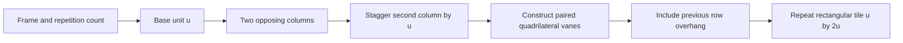

# Yagasuri construction pilot

Status: implemented candidate, version `yagasuri-2` (documentation identifier; not yet a runtime catalog field). Reviewed 2026-10-28 against `_references/Japanese/Yagasuri.jpg`. This is a geometric reconstruction of that image's motif, not a universal or historically authenticated definition.

## Observations and assumptions

The image shows paired long feather vanes, a narrow vertical shaft gap, alternating upward/downward columns, and a half-period vertical stagger. Solid and open areas alternate; omitting the stagger or filling every vertical interval produces a different pattern. The original generator's rectangular bars and short triangular caps did not form this structure.

Use straight quadrilateral vanes with idealized symmetry. The ratios below are visual estimates from the supplied raster, not measured historical constants. Exclude mottling, local distortion, and color variation. Preserve the user's line color and background choices; accent color and stroke thickness do not affect this filled motif, as before. A later inspector should hide unsupported controls.

## Coordinate system and equations

SVG coordinates: x increases right, y increases down. Let `u = frame / repetitions`, preserving the current global size convention. Repetitions controls this base unit, not an exact count of complete tiles on each axis.

| Quantity | Definition |
| --- | --- |
| Column pitch `p` | `u / 2` |
| Outer inset `a` | `0.02u` |
| Shaft gap `g` | `0.04u` |
| Slanted end rise `d` | `0.25u` |
| Vertical body length `b` | `0.94u` |
| Tile dimensions | `W = u`, `H = 2u` |
| Repeat vectors | `(u, 0)`, `(0, 2u)` |

The vertical feather extent is `b + d = 1.19u`, so some tips overhang their row interval. Neighboring colored feathers are staggered by `u`; each individual column repeats after `2u`.

For column `c` in `{0, 1}` and repeat row integer `r`:

```text
center = (c + 1/2)p
xL = cp + a                 xR = (c + 1)p - a
xIL = center - g/2          xIR = center + g/2
y = 2ru + (c == 0 ? u : 0)
yOuter = y + (c == 0 ? 0 : d)
yInner = y + (c == 0 ? d : 0)

left vane:
  (xL, yOuter), (xIL, yInner), (xIL, yInner+b), (xL, yOuter+b)
right vane:
  (xIR, yInner), (xR, yOuter), (xR, yOuter+b), (xIR, yInner+b)
```

Render both columns for `r = -1, 0`. The previous row supplies the overhanging tips at the top boundary; the SVG pattern clips overhang at the bottom. Horizontal insets keep vanes clear of the left/right boundary. Each tile emits eight quadrilaterals, including off-tile geometry, with explicit fill and no stroke or external dependencies. Existing four-decimal SVG serialization remains unchanged.



## Acceptance evidence

- [Before/reference/after comparison](data/reference-audit-2026-10-28/yagasuri-comparison.html) and [Edge capture](data/reference-audit-2026-10-28/yagasuri-comparison.png). Before/after share unit 40 and the same palette. The source is scaled to fit, so this is structural comparison, not density-normalized image matching.
- [Standalone candidate SVG](data/reference-audit-2026-10-28/yagasuri-after.svg).
- Paired slanted vanes and narrow shaft gaps replace separate bars/caps.
- Alternating direction and half-period stagger restore the alternating open areas seen in the reference. No visible discontinuity was found in the inspected Edge repeated-field rendering.
- Ratios and final visual match remain open to user review; no pixel-equivalence or cross-tool certification is claimed.

## Tests and usage

From the `_CODE` workspace:

```powershell
node --test _Vectors/tests/yagasuri.test.cjs
```

The dependency-free Node tests evaluate the shipped inline generator definitions, check topology and empty spaces, compare sampled seam occupancy against an independent analytic field, test minimum/default/maximum UI sizes, reject nonpositive/non-finite units, and compare the other eight generators to captured baseline output. Samples avoid polygon boundaries where four-decimal rounding makes inside/outside classification ambiguous.

For manual checking, open `_Vectors/index.html`, locate Yagasuri, change repetitions/frame size and line/background colors, and inspect the paired vanes and stagger. Export SVG and open it separately. The saved SVG artifact is a construction fixture, not evidence that the clipboard/download interaction was tested.

## Limits and next work

- The validator rejects invalid units explicitly; the UI's broader global input validation remains separate work.
- Geometry count is constant per tile (eight polygons); no new runtime dependencies or gallery-wide rendering changes were introduced. Performance has not been benchmarked.
- Test extraction from inline definitions is temporary and should become direct module imports during generator separation.
- Do not expose arbitrary slope/body/gap controls until their constraints and expected repeat behavior are specified.
- Next: Seigaiha construction specification, then correction; preserve other patterns until their scoped tasks.
